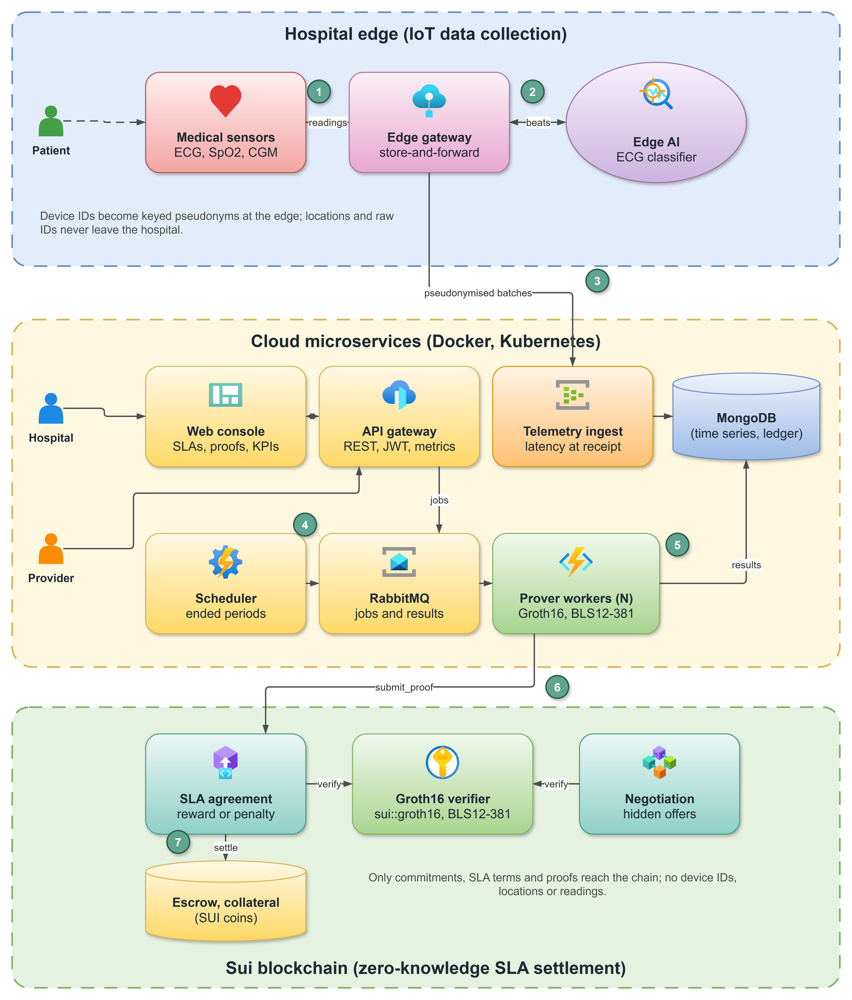

# Web Interface for Microservice Healthcare Edge-Cloud AIoT Deployment Applications.

## Overview

Healthcare IoT services rely on SLAs that guarantee QoS properties such as latency and availability. These SLAs are usually enforced by centralised providers, which offers little transparency. The arrangement also exposes sensitive deployment data, such as device identifiers, patient links and sensor locations. The project proposes an alternative in which providers prove SLA compliance with **zk-SNARKs (Groth16)**. The proofs are verified natively on the **Sui** blockchain, and smart contracts apply penalties or incentives automatically. Throughout the process, the underlying data stays private.

The project is carried out by Huyen-Trang Le and Huu-Hung Vuong under the supervision of Dr. Adnan Imeri and Prof. Nazim Agoulmine (COSMO Team, ISIBC Laboratory).

## Platform repositories

| Repository                                                          | Role                                                                                                                      |
| ------------------------------------------------------------------- | ------------------------------------------------------------------------------------------------------------------------- |
| [contracts](https://github.com/Shaker-Genopole/contracts)           | Sui Move package: native Groth16 (BLS12-381) verifier registry, SLA escrow, ZK resource negotiation                       |
| [zk-circuits](https://github.com/Shaker-Genopole/zk-circuits)       | `sla_compliance` and `resource_negotiation` circuits, prover and Sui encoders                                             |
| [services](https://github.com/Shaker-Genopole/services)             | Dockerised microservices: api-gateway, telemetry-ingest, edge-agent, scheduler, prover-worker, taskmanager, chain-indexer |
| [infrastructure](https://github.com/Shaker-Genopole/infrastructure) | Compose stack from published images, Kubernetes with autoscaling, Terraform (GKE)                                         |
| **fontend**                                                         | This web console                                                                                                          |

## Architecture

<p align="center">
  <a href="docs/architecture.pdf"></a>
</p>

_Figure 1. Platform architecture ([PDF](docs/architecture.pdf), source [docs/architecture.drawio](docs/architecture.drawio)). The numbered steps trace one SLA period from sensor to settlement. Icons: Microsoft Azure architecture icons and draw.io basic shapes._

1. Sensors stream vital signs to the edge gateway.
2. The edge AI classifies ECG beats locally and flags anomalies.
3. Pseudonymised batches reach the telemetry ingest, which measures sensor-to-cloud latency.
4. The scheduler queues every SLA period that has ended.
5. A prover worker checks the period and produces a Groth16 proof (BLS12-381).
6. The proof is submitted to Sui and verified natively by `sui::groth16`.
7. The agreement releases the reward, or the consumer claims the penalty after the grace window.

### Verification scenarios

```mermaid
flowchart TB
  subgraph S1["<b>Scenario 1 (SLA compliance)</b>"]
    direction LR
    t1(["<b>Hidden deployment telemetry</b><br/>devices, locations, readings"])
    p1{{"<b>Groth16 proof</b><br/>ECG ≤ 2 s for 95 %, availability ≥ 99 %,<br/>glucose gap ≤ 5 min"}}
    v1(["<b>Sui verifies</b><br/>reward or penalty"])
    t1 --> p1 --> v1
  end
  subgraph S2["<b>Scenario 2 (resource negotiation)</b>"]
    direction LR
    t2(["<b>Hidden provider capabilities</b><br/>storage, latency, cost, CPU"])
    p2{{"<b>Groth16 proof</b><br/>offer satisfies the<br/>consumer's constraints"}}
    v2(["<b>Sui verifies</b><br/>offer qualifies, consumer selects"])
    t2 --> p2 --> v2
  end

  classDef secret fill:#f8cecc,stroke:#b85450,color:#3d0d0b,stroke-width:1.5px
  classDef proof fill:#d5e8d4,stroke:#82b366,color:#14300f,stroke-width:1.5px
  classDef chain fill:#dae8fc,stroke:#6c8ebf,color:#132a4a,stroke-width:1.5px
  class t1,t2 secret
  class p1,p2 proof
  class v1,v2 chain
  style S1 fill:#fffaf0,stroke:#d6b656,stroke-width:1.5px,stroke-dasharray:6 4
  style S2 fill:#faf5ff,stroke:#9673a6,stroke-width:1.5px,stroke-dasharray:6 4
```



## Modules

| Route                         | Module                                           |
| ----------------------------- | ------------------------------------------------ |
| `/`                           | SLA overview and evaluation KPIs                 |
| `/sla-contracts`              | SLA contracts (Sui objects, escrow, penalties)   |
| `/zk-proofs`                  | Groth16 proof ledger                             |
| `/proof-lab`                  | Interactive proof pipeline (Scenario 1)          |
| `/negotiation`                | Constraint-based provider selection (Scenario 2) |
| `/devices`, `/infrastructure` | IoT devices and edge–cloud resources             |

The template's original modules (tasks, users, apps, chats, Clerk authentication and settings) are retained.

## Data sources

The console has two modes:

- **Synthetic (default).** All data is generated from a fixed seed in [src/data/dataset.ts](src/data/dataset.ts). The proof lab in [src/lib/zk/simulator.ts](src/lib/zk/simulator.ts) is a simulation: its commitments are real SHA-256 digests, but its proofs and timings are illustrative.
- **Live (`VITE_LIVE_API=true`).** Sign-in, the dashboard KPIs and the proof ledger come from the api-gateway of [services](https://github.com/Shaker-Genopole/services). That means real Groth16 BLS12-381 proofs, telemetry latency and gas. Pages that have no backend endpoint yet keep the synthetic data.

## Getting started

Requirements: Node.js ≥ 22 and pnpm 11.

```bash
pnpm install
pnpm dev      # http://localhost:5173
pnpm build    # production bundle in dist/
pnpm test     # Vitest (browser mode)
```

`VITE_CLERK_PUBLISHABLE_KEY` is optional and only enables the `/clerk/*` pages.

Live mode against a local gateway:

```bash
VITE_LIVE_API=true VITE_API_URL=http://localhost:8080 pnpm dev
```

Container image (nginx on port 8080, proxies `/api` to `API_UPSTREAM`):

```bash
docker build -t zk-sla-console .
docker run -p 8088:8080 -e API_UPSTREAM=http://host.docker.internal:8080 zk-sla-console
```

## CI/CD

The GitHub Actions workflow [.github/workflows/ci.yml](.github/workflows/ci.yml) lints, tests and builds the project on every push and pull request to `main`. It then deploys to **Vercel**: a production deployment for `main` and a preview deployment for pull requests. To enable deployment, add the repository secrets `VERCEL_TOKEN`, `VERCEL_ORG_ID` and `VERCEL_PROJECT_ID`.

## Stack

React 19, TypeScript, Vite, TanStack Router/Query/Table, shadcn/ui, Tailwind CSS 4, Recharts.

## Acknowledgements

The UI is built on [shadcn-admin](https://github.com/satnaing/shadcn-admin) by Sat Naing (MIT licence).
